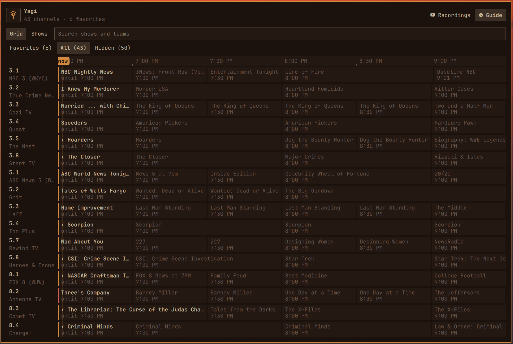
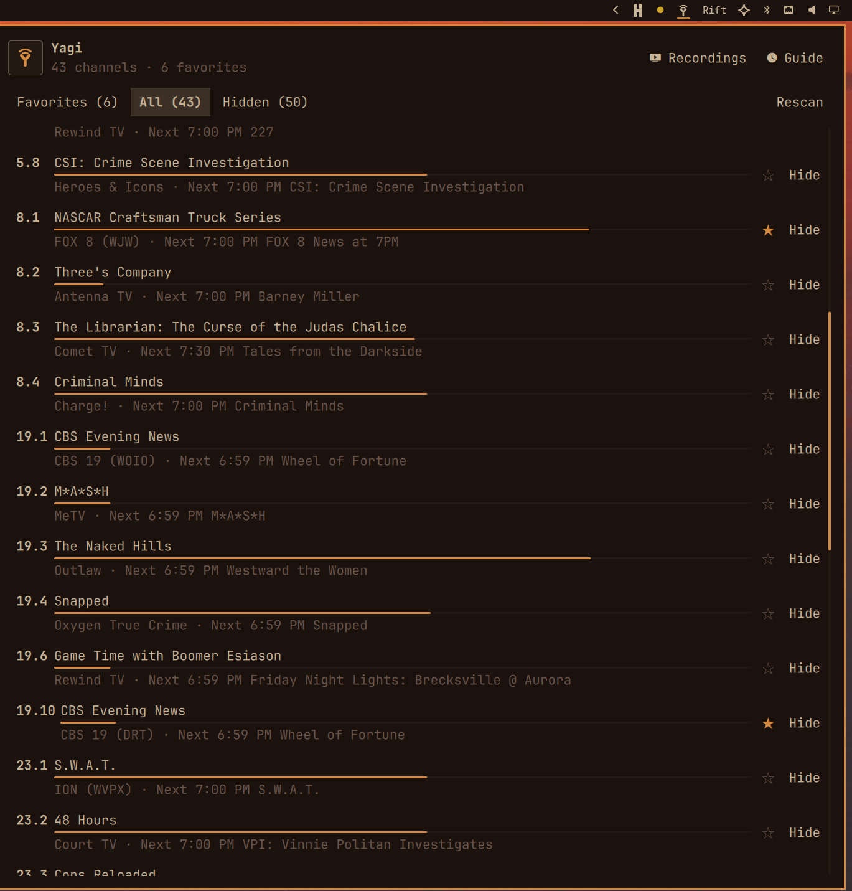
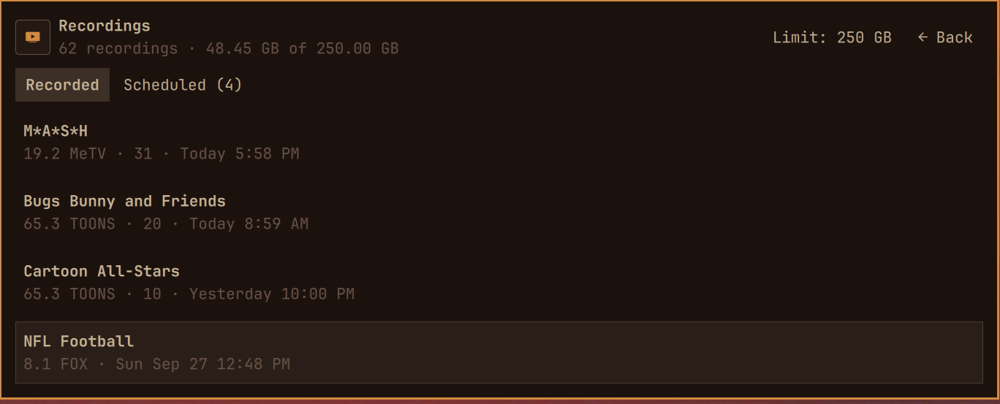

# Yagi

Watch, pause, and record free over-the-air TV from the Omarchy bar. Yagi scans ATSC 1.0 stations, shows the listings those stations broadcast, and records to your videos folder.



<table>
  <tr>
    <td width="50%" valign="top"></td>
    <td width="50%" valign="top"></td>
  </tr>
</table>

## Requirements

- [Omarchy](https://omarchy.org/). mpv, ffmpeg, and Python already come with it.
- An antenna.
- An ATSC 1.0 tuner that Linux shows as `/dev/dvb/adapterN/frontend0`.

| Tuner | |
| --- | --- |
| Hauppauge WinTV-dualHD, ATSC model (`2040:826d`) | Tested. Two tuners. `lsusb` may call this ID a 955D. |
| Other ATSC tuners with a Linux DVB driver | Untested. Yagi uses every adapter it finds. |
| HDHomeRun and other network tuners | Not supported. They have no `/dev/dvb` device. |
| ATSC 3.0 | Not supported. |

One tuner can watch or record, not both. The exception: a station on the same tower as the one you are watching (for example 8.2 while on 8.1) is copied from the live picture and needs no second tuner. Two tuners can watch and record at the same time.

## Install

```bash
omarchy plugin add https://github.com/rickbacci/yagi.git --enable
```

Omarchy asks you to confirm, then puts the TV icon on the right side of the bar. Run it in a terminal. It offers a section picker with Right already chosen.

## First run

1. Click the TV icon and choose Scan. Nothing is listed until a scan finishes.
2. Press `g` to open the Guide. The first time, Yagi reads the listings from each tower once. That takes a few minutes and needs a free tuner. Stations send about the next several hours.
3. Press `g` again to close the Guide. The channel list opens on Favorites, so it starts empty. Press `a` for All, then click ☆ on the stations you want.

## Using it

### Panel

| Key | Action |
| --- | --- |
| `g` | Open or close the Guide |
| `v` | Open or close Recordings |
| `f` / `a` | Favorites / All channels |
| Shift+S | Scan again |
| ↑ / ↓ | Move through the list |
| Enter | Watch the selected channel |
| `r` | Record the selected channel, or stop its recording |
| Esc | Close the open view, then the panel |

### Guide

| Key | Action |
| --- | --- |
| `s` | Switch between Grid and Shows |
| Arrows | Move. On Shows, ← / → change the time of day |
| Enter | Watch a show that is on now, or record a later one |
| `r` | Record the selected airing. Again to cancel |
| `a` | Record every airing of that show on that channel. Again to stop. Needs the record timer |
| `/` | Search. The Grid matches titles and descriptions. Shows matches titles |

Refresh reads the listings again. Opening the Guide again does not.

### TV window

Once the picture has focus:

| Key | Action |
| --- | --- |
| Space | Pause or resume |
| ← / → | Skip 10 seconds |
| ↑ / ↓ | Skip 1 minute |
| PgUp / PgDn | Next or previous ad break, on a recording |
| `j` / `k` | Previous or next channel |
| `l` | Back to live |
| `r` | Record this station, or stop its recording |
| `y` | Save the paused stretch to Recordings |
| `f` or double-click | Fullscreen. Again, or Esc, returns to the small picture |
| `i` | Picture stats |
| `c` | Captions |
| `a` | The other audio, when the station sends more than one. The next station starts in English again |
| `m` | Mute. The wheel changes the volume. The next open keeps both |

Pause is not a recording. Close TV deletes the pause file, unless a recording is still copying it. Ad breaks are marked after a recording ends. Comskip is used when it is installed. Otherwise ffmpeg looks for black frames and silence. On playback, each marked break is skipped once on its own. Press ← to watch it.

## Optional

### Scheduled and series recordings

Watching, pausing, recording what is on, and the Guide all work without this. Scheduled and series recordings need the record timer:

```bash
python3 ~/.config/omarchy/plugins/richardb.yagi/bin/yagi install
```

`yagi status` then says the record timer is on.

### Station names

Names and network labels are not in the broadcast. To add them, copy a station map to `~/.config/yagi/station_map.json`. [`markets/cleveland.json`](markets/cleveland.json) shows the file shape. Without it, Yagi uses the names from the scan.

### Command line

The CLI is `~/.config/omarchy/plugins/richardb.yagi/bin/yagi`. Put that `bin/` on your `PATH` to type just `yagi`.

```bash
yagi status
yagi scan
yagi play "8.1"
yagi guide search News
yagi record start 8.1 1h
yagi record list
yagi series
```

Durations look like `30m`, `1h`, or `300s`.

## Update

```bash
omarchy plugin update richardb.yagi
```

It shows the changes, asks you to confirm, and reloads the plugin. With no ID, it updates every plugin you added from git. If the record timer is on, it picks up the new version on its next run, within a minute.

## Troubleshooting

**No channels.** Scan from the bar. `yagi status` should list an adapter with ATSC in its systems. If `/dev/dvb/adapter0/frontend0` is not readable by your user, log out and back in. Do not change its mode as root.

**The Guide is empty.** The Guide shows the same list as the panel, Favorites or All. If you have not starred any stations, press `g` to close the Guide, `a` for All, and `g` again. If All has channels but no titles, leave a tuner free and press Refresh. A read takes a few minutes, and the panel shows which tower it is on. If listings could not be saved, the panel says why above the Guide.

**Can't watch and record at once.** That needs two tuners, unless both stations are on the same tower.

**Fullscreen will not stick.** An older Hyprland rule is pinning class `yagi`. Yagi places and pins the picture itself, so you do not need a rule. See [Picture window](#picture-window) for one that leaves pinning to Yagi.

## Uninstall

If you turned on the record timer, stop it first with the first command. Otherwise the second is enough.

```bash
python3 ~/.config/omarchy/plugins/richardb.yagi/bin/yagi uninstall
```

```bash
omarchy plugin remove richardb.yagi
```

Your recordings and settings stay. See below for what is left behind.

## Where things are stored

| | |
| --- | --- |
| Channels, Guide, favorites, schedule, recordings index | `~/.config/yagi/` |
| Recordings | `~/Videos/TV` (`$XDG_VIDEOS_DIR/TV` when that variable is set) |
| Pause file, removed when you close TV | `~/.cache/yagi/timeshift/live.ts` |
| Tuner channel table | `~/.config/mpv/channels.conf` |
| Record timer's copy of Yagi, only after `yagi install` | `$XDG_DATA_HOME/yagi`, or `~/.local/share/yagi` |

Updates do not touch `~/.config/yagi` or `~/Videos/TV`. `yagi uninstall` removes the record timer's copy. Uninstalling leaves `~/.config/yagi`, `~/Videos/TV`, `~/.cache/yagi`, and `~/.config/mpv/channels.conf`. Delete them yourself if you want them gone.

## Development

Symlink this checkout in as the plugin, then put it on the bar:

```bash
ln -sfn "$(pwd)" ~/.config/omarchy/plugins/richardb.yagi
omarchy bar put richardb.yagi --section right
omarchy restart shell
```

`omarchy plugin validate` the git root. Validating the symlink under `~/.config/omarchy/plugins/` fails because that path is a symlink.

`scripts/dev-setup.sh` is opt-in. It installs python3, luajit (also available as `lua`), psmisc (`fuser`), nodejs, ffmpeg, mpv, procps, jq, Qt 6's `qmltestrunner` and `qmllint` with the Quick modules, and `ruff`, and it enables linger so the user manager exists. Run it when you mean to. The automatic setup hook is `scripts/setup-test-env.sh`, which only checks that those tools are already on `PATH`. It does not install packages or enable linger.

The bar and the picture find `bin/yagi` beside the plugin. `PATH` is only for typing `yagi` in a terminal. `python3 bin/yagi` always runs the script you name. Watch, pause, record-now, scan, and the Guide do not need `install`. `install` publishes `HEAD` to `$XDG_DATA_HOME/yagi/current`, or to `~/.local/share/yagi/current` when `XDG_DATA_HOME` is unset, and starts the record timer. That timer runs the published copy, not the working tree. If it is already on, a plugin update is enough. The timer publishes the new commit on a later tick.

The shell can open the panel without the bar icon: `omarchy-shell shell toggle richardb.yagi`.

### Tests

From the repo root:

```bash
bash scripts/dev-setup.sh
python3 -m unittest
python3 bin/yagi status
python3 scripts/pre_review.py
```

A missing test tool fails the suite; it is not a skip. The suite loads `plugin/BarWidget.qml` and every page offscreen with Qt 6 (`/usr/lib/qt6/bin/qmltestrunner`, or another binary that reports Qt 6). A Qt 5 `qmltestrunner` earlier on `PATH` is not used. If that runner is missing, the failure names `qt6-declarative` / `qt6-declarative-dev-tools`. When pid 1 is systemd, the suite checks that a scope leaves the caller's cgroup, using the real `XDG_RUNTIME_DIR`. A missing user-manager socket fails that test. It skips only when pid 1 is not systemd. The other skip is the live ATSC tuner test.

Tests set their own `XDG_*` directories and do not read or write `~/Videos/TV` or `~/.config/yagi`. They do not put sockets in `/tmp`. They reject a non-item, such as a hover handler or a timer, placed directly in `KeyboardPanel`. They also reject an editable text field (`TextField`, `TextInput`, `TextEdit`, `TextArea`) that is not inside a `Loader` whose `active` starts false.

After a QML change, `omarchy restart shell`.

### Pre-review

```bash
python3 scripts/pre_review.py
```

Exit 0 is pass. A failure prints a FAIL line for each of these checks:

- Parsers stop at the end of the buffer, and repeated sections do not pile up.
- Captured command output is size-capped, and a timeout kills the process group.
- The release snapshot stays on the allowlist, and automatic setup does not use privilege.
- Clipboard paste is capped at 256 bytes, which holds a full guide search.
- Git names the checkout it reads, and the read is size-capped.
- A captured command never signals the caller's own process group.
- A machine with no tuner is not told that both tuners are busy.
- A missing mpv does not crash the player.
- The release copy and the record timer follow XDG_DATA_HOME.
- Agent and dev files stay out of the plugin copy.
- Omarchy plugin validate accepts this plugin.
- qmllint accepts the plugin QML.
- ruff accepts the Python.

### Releasing

The version lives only in `manifest.json`. Pushing a tag `v` plus that version runs `.github/workflows/release.yml`. The workflow refuses the tag when it does not match `manifest.json`, then publishes a GitHub release whose notes are that version's section of `CHANGELOG.md`.

Check the tag locally before pushing it. This does not create a tag or a release:

```bash
python3 scripts/check-release-tag.py v0.1.7
python3 scripts/check-release-tag.py --notes
```

### Picture window

The picture is a floating window of class `yagi`, at the bottom right, about a third of the monitor tall. Yagi places and pins that window itself. You do not need a Hyprland rule to watch. In the picture, `f` or a double-click fullscreens. `f`, double-click, or Esc returns to the small window. Super+F does nothing while the picture is pinned. `i` shows player stats.

Use this rule when an older rule pins class `yagi` and fullscreen will not stick. Do not set `pin = true` here. A pin is put back the moment the window leaves fullscreen.

The opacity line is what the rest of the window rules expect:

```lua
o.window({ class = "^yagi$", fullscreen = false }, {
  tag = "-default-opacity",
  float = true,
  keep_aspect_ratio = true,
  border_size = 0,
  size = { "(monitor_h*16/27)", "(monitor_h/3)" },
  opacity = "1 1",
  move = { "(monitor_w-(monitor_h*16/27)-40)", "(monitor_h-(monitor_h/3)-40)" },
})
o.window("yagi", {
  no_shortcuts_inhibit = true,
  tag = "-default-opacity",
  opacity = "1 1",
})
```

```bash
hyprctl reload && hyprctl configerrors
```

## License

[MIT](LICENSE)
