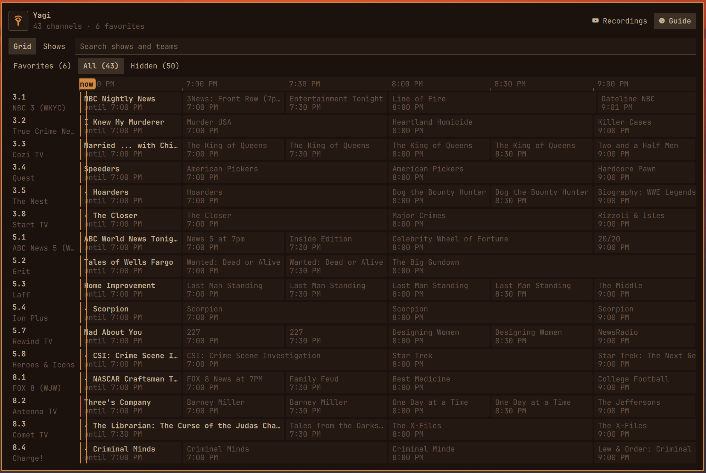
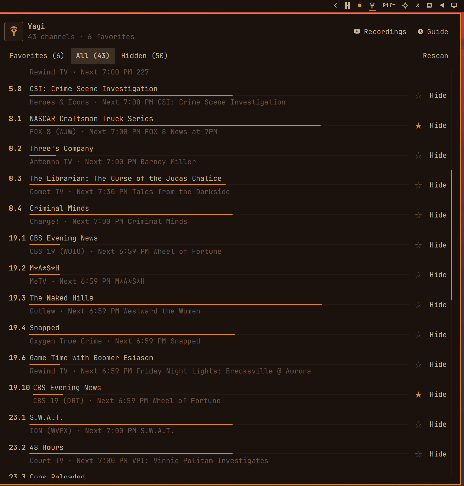
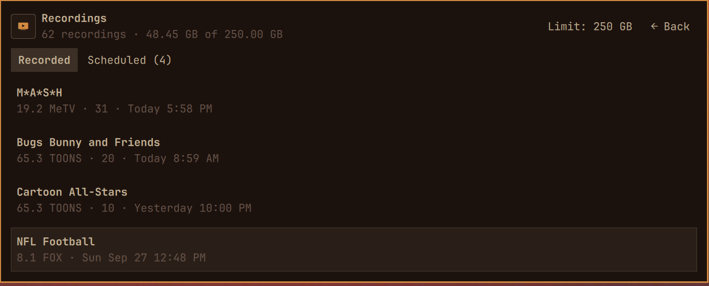

# Yagi

Watch, pause, and record free over-the-air TV from the Omarchy bar. Yagi scans ATSC 1.0 stations, shows the listings those stations broadcast, and records to your videos folder.



<table>
  <tr>
    <td width="50%" valign="top"></td>
    <td width="50%" valign="top"></td>
  </tr>
</table>

## Requirements

- [Omarchy](https://omarchy.org/) (Hyprland and Quickshell on Arch Linux)
- An antenna
- An ATSC 1.0 tuner that Linux shows as `/dev/dvb/adapterN/frontend0` with ATSC in its delivery systems

| Tuner | |
| --- | --- |
| Hauppauge WinTV-dualHD, ATSC model (`2040:826d`) | Tested. Two tuners. `lsusb` may call this ID a 955D. |
| Other ATSC tuners with a Linux DVB driver | Untested. Yagi uses every adapter it finds. |
| HDHomeRun and other network tuners | Not supported. They have no `/dev/dvb` device. |
| ATSC 3.0 | Not supported. |

One tuner can watch or record, not both, except that recording the station you are already watching copies the live picture and does not need a second tuner. Two tuners can watch and record at the same time.

Check a tuner after the packages below are installed:

```bash
dvb-fe-tool -a 0
```

The report should list `ATSC`. A second tuner is `-a 1`.

## Install

```bash
sudo pacman -S --needed mpv v4l-utils psmisc procps-ng python
omarchy plugin add https://github.com/rickbacci/yagi.git
omarchy plugin enable richardb.yagi
omarchy bar put richardb.yagi --section right
omarchy restart shell
```

Then start the record timer, which fills the Guide and starts scheduled recordings. Run it from the plugin directory. `install` uses that copy of the program, not whatever directory you happen to be in:

```bash
cd ~/.config/omarchy/plugins/richardb.yagi
python3 bin/yagi install
```

`python3 bin/yagi status` should say the record timer is on.

The picture is a floating window of class `yagi`, at the bottom right. Do not pin it in this rule. A pin here is put back the moment the window is not fullscreen, and fullscreen never sticks. Yagi pins the small picture itself, and pins it again when you leave fullscreen.

Replace any older `yagi` rule, including one that sets `pin = true`, with this block. Then reload. Until you do, `f` unpins the window and the rule pins it again before fullscreen can stick.

```lua
o.window({ class = "^yagi$", fullscreen = false }, {
  tag = "-default-opacity",
  float = true,
  keep_aspect_ratio = true,
  border_size = 0,
  size = { "(monitor_h*16/27)", "(monitor_h/3)" },
  opacity = "1 1",
  move = { "(monitor_w-(monitor_h*16/27)-40)", "(monitor_h-(monitor_h/3)-40)" },
})
```

```bash
hyprctl reload
```

In the picture, `f` or a double-click fullscreens. `f`, double-click, or Esc returns to the small pinned window. Super+F does not unpin, so it still does nothing while the picture is pinned. `i` shows player stats (resolution, codec, hardware decode).

If `/dev/dvb/adapter0/frontend0` is not readable by your user, log out and back in on the seat. Do not change its mode as root.

## First run

1. Open Yagi from the bar and choose Scan. Nothing is listed until a scan finishes.
2. Leave a tuner free. The record timer reads the Guide on its own. With a typical set of towers that takes a few minutes. Listings are only what each station sends, usually the next several hours.
3. The channel list opens on Favorites. Switch to All and star the stations you want. An empty Favorites tab is not an empty scan.

Names and network labels are not in the broadcast. To supply them, copy a station map to `~/.config/yagi/station_map.json`. `markets/cleveland.json` is one example of the file shape. Without that file, Yagi uses the names from the scan.

## Update

```bash
omarchy plugin update
cd ~/.config/omarchy/plugins/richardb.yagi
python3 bin/yagi install
```

`omarchy plugin update` downloads the new plugin. `python3 bin/yagi install` publishes that commit for the record timer. Run install when you want the timer to pick up the update immediately. If you skip it, the timer publishes the new commit on a later tick.

An update does not change `~/.config/yagi` or `~/Videos/TV`.

## Using it

Open the panel from the bar icon. `g` opens the Guide, `v` opens Recordings, `f` is Favorites, `a` is All, and Shift+S scans again. Esc closes the panel.

On the channel list, Enter watches and `r` records. In the Guide, Enter watches the show that is on now, or records a later one. `r` records the selected airing. `a` records that series every week. `/` searches titles and descriptions.

Pause is not a recording. Close TV deletes the pause file. `y` while paused saves that stretch into Recordings. Recordings are kept in the library. Ad breaks are marked after a recording ends. Comskip is used when it is installed. Otherwise ffmpeg looks for black frames and silence.

The TV window, once it has focus:

| Key | Action |
| --- | --- |
| Space | Pause or resume |
| ← / → | Skip 10 seconds. On a recording, an ad break is skipped once |
| ↑ / ↓ | Skip 1 minute |
| j / k | Previous or next channel |
| l | Back to live |
| r | Record this station |
| y | Save the paused stretch |
| f or double-click | Fullscreen. Again, or Esc, returns to the small picture |
| i | Picture stats |
| c | Captions |
| m | Mute |

From a terminal, if `yagi` is on your `PATH`:

```bash
yagi status
yagi scan
yagi play "8.1"
yagi guide search News
yagi record start 8.1 1h
yagi record list
yagi series
```

If the shell cannot find `yagi`, call `~/.config/omarchy/plugins/richardb.yagi/bin/yagi` with the same arguments. Durations look like `30m`, `1h`, or `300s`.

## Where things are stored

| | |
| --- | --- |
| Channels, Guide, favorites, schedule, recordings index | `~/.config/yagi/` |
| Recordings | `~/Videos/TV` (`$XDG_VIDEOS_DIR/TV` when that variable is set) |
| Pause file, removed when you close TV | `~/.cache/yagi/timeshift/live.ts` |
| Tuner channel table | `~/.config/mpv/channels.conf` |

Updates and `python3 bin/yagi uninstall` do not delete `~/.config/yagi` or `~/Videos/TV`.

## Troubleshooting

**The Guide is empty.** Favorites is the default tab. Choose All if you have not starred any stations. If All has channels but no show titles, the Guide has not been read yet, or the last read failed. A normal read takes a few minutes and needs a free tuner.

```bash
journalctl --user -u yagi-guide.service -n 80 --no-pager
~/.config/omarchy/plugins/richardb.yagi/bin/yagi status
```

`status` should say the record timer is on. The Guide journal should show towers being read, then the service going idle. An error line there is the reason the listings were not saved.

**No channels.** Scan from the bar. `dvb-fe-tool -a 0` should report `ATSC`, and `/dev/dvb/adapter0/frontend0` should be readable by your user.

**Watch and record at once.** That needs two tuners, unless you record the station already on screen.

## Uninstall

Stop the timer before removing the plugin. Recordings and settings stay.

```bash
cd ~/.config/omarchy/plugins/richardb.yagi
python3 bin/yagi uninstall
omarchy plugin remove richardb.yagi
```

Development notes, tests, and the window-rule details are in [CONTRIBUTING.md](CONTRIBUTING.md).
