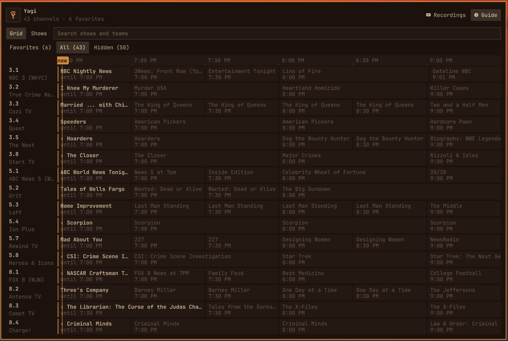
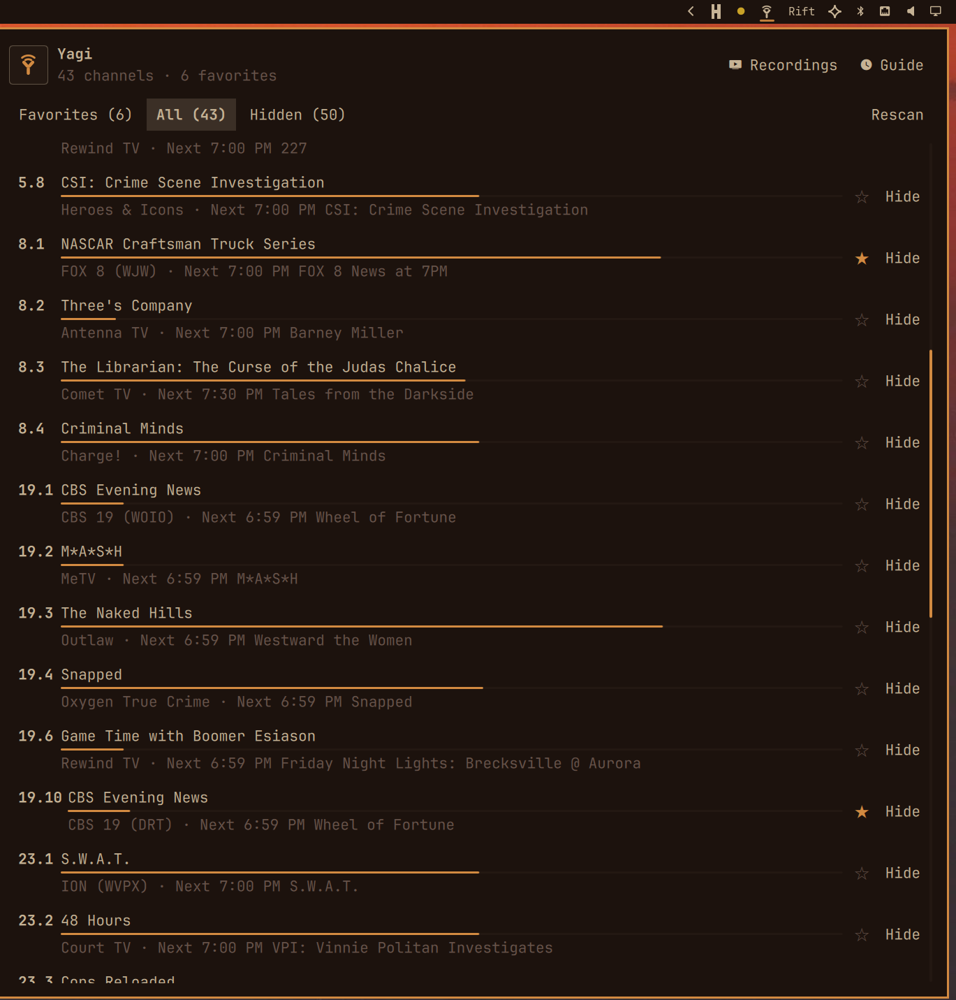
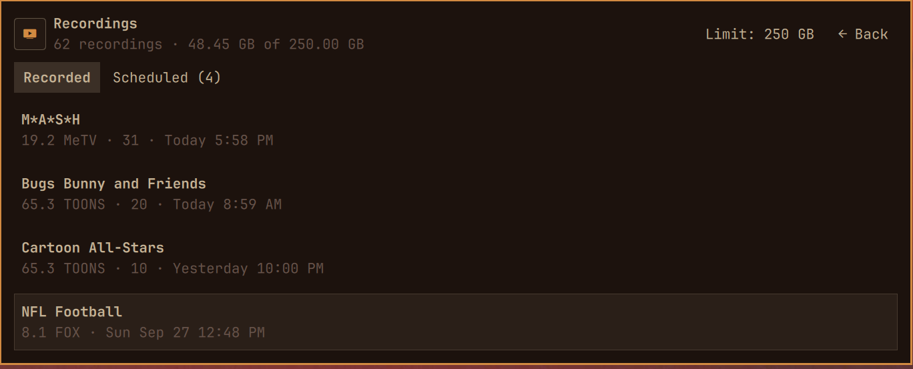

# Yagi

Watch, pause, and record free over-the-air TV from the Omarchy bar. Yagi scans ATSC 1.0 stations, shows the listings those stations broadcast, and records to your videos folder.



<table>
  <tr>
    <td width="50%" valign="top"></td>
    <td width="50%" valign="top"></td>
  </tr>
</table>

## Requirements

- [Omarchy](https://omarchy.org/) (Hyprland and Quickshell on Arch Linux)
- An antenna
- An ATSC 1.0 tuner that Linux shows as `/dev/dvb/adapterN/frontend0` with ATSC in its delivery systems

| Tuner | |
| --- | --- |
| Hauppauge WinTV-dualHD, ATSC model (`2040:826d`) | Tested. Two tuners. `lsusb` may call this ID a 955D. |
| Other ATSC tuners with a Linux DVB driver | Untested. Yagi uses every adapter it finds. |
| HDHomeRun and other network tuners | Not supported. They have no `/dev/dvb` device. |
| ATSC 3.0 | Not supported. |

One tuner can watch or record, not both, except that recording the station you are already watching copies the live picture and does not need a second tuner. Two tuners can watch and record at the same time.

`yagi status` names each adapter it can open. One that supports ATSC is ready to scan.

## Install

mpv, ffmpeg, and Python are already on Omarchy. Yagi does not need another package.

```bash
omarchy plugin add https://github.com/rickbacci/yagi.git
omarchy plugin enable richardb.yagi
omarchy bar put richardb.yagi --section right
omarchy restart shell
```

That is the whole install. Scan, watch, pause, record the station that is on, and the Guide all work from the bar. The first time you open the Guide, and a scan has already found channels, Yagi reads the listings once. Refresh reads them again when you ask. Neither of those starts the record timer.

Scheduled recordings and series recordings stay off until you turn that timer on. From the plugin directory:

```bash
cd ~/.config/omarchy/plugins/richardb.yagi
python3 bin/yagi install
```

`yagi status` then says the record timer is on. Skip this if you only watch, pause, and record what is on now.

If `/dev/dvb/adapter0/frontend0` is not readable by your user, log out and back in on the seat. Do not change its mode as root.

## First run

1. Open Yagi from the bar and choose Scan. Nothing is listed until a scan finishes.
2. Open the Guide. The first time, with channels and no listings, Yagi reads each tower once. That takes a few minutes and needs a free tuner. Listings are only what each station sends, usually the next several hours. Opening the Guide again does not start another read. Refresh does, when you want a new one.
3. The channel list opens on Favorites. Switch to All and star the stations you want. An empty Favorites tab is not an empty scan.

Names and network labels are not in the broadcast. To supply them, copy a station map to `~/.config/yagi/station_map.json`. `markets/cleveland.json` is one example of the file shape. Without that file, Yagi uses the names from the scan.

## Update

```bash
omarchy plugin update
```

`omarchy plugin update` downloads the new plugin. If the record timer is already on, its next tick publishes that commit.

An update does not change `~/.config/yagi` or `~/Videos/TV`.

## Using it

Open the panel from the bar icon. `g` opens the Guide, `v` opens Recordings, `f` is Favorites, `a` is All, and Shift+S scans again. Esc closes the panel.

On the channel list, Enter watches and `r` records. In the Guide, Grid and Shows switch the list. Refresh reads the listings once, even when titles are already on screen, and does not start the record timer. Enter watches the show that is on now, or records a later one. `r` records the selected airing. `a` records that series every week, once the record timer is on. `/` searches titles and descriptions.

Pause is not a recording. Close TV deletes the pause file. `y` while paused saves that stretch into Recordings. Recordings are kept in the library. Ad breaks are marked after a recording ends. Comskip is used when it is installed. Otherwise ffmpeg looks for black frames and silence.

The TV window, once it has focus:

| Key | Action |
| --- | --- |
| Space | Pause or resume |
| ← / → | Skip 10 seconds. On a recording, an ad break is skipped once |
| ↑ / ↓ | Skip 1 minute |
| j / k | Previous or next channel |
| l | Back to live |
| r | Record this station |
| y | Save the paused stretch |
| f or double-click | Fullscreen. Again, or Esc, returns to the small picture |
| i | Picture stats |
| c | Captions |
| a | The other audio, when this station sends more than one. The next station starts in English again |
| m | Mute. The wheel changes the volume. The next open uses this volume and mute |

From a terminal, if `yagi` is on your `PATH`:

```bash
yagi status
yagi scan
yagi play "8.1"
yagi guide search News
yagi record start 8.1 1h
yagi record list
yagi series
```

If the shell cannot find `yagi`, call `~/.config/omarchy/plugins/richardb.yagi/bin/yagi` with the same arguments. Durations look like `30m`, `1h`, or `300s`.

## Where things are stored

| | |
| --- | --- |
| Channels, Guide, favorites, schedule, recordings index | `~/.config/yagi/` |
| Recordings | `~/Videos/TV` (`$XDG_VIDEOS_DIR/TV` when that variable is set) |
| Pause file, removed when you close TV | `~/.cache/yagi/timeshift/live.ts` |
| Tuner channel table | `~/.config/mpv/channels.conf` |

Updates and `python3 bin/yagi uninstall` do not delete `~/.config/yagi` or `~/Videos/TV`.

## Troubleshooting

**The Guide is empty.** Favorites is the default tab. Choose All if you have not starred any stations. If All has channels but no show titles, open the Guide once and leave a tuner free. The first open reads the listings. Refresh asks for another read. A read takes a few minutes. While it runs, the panel says which tower it is on.

```bash
~/.config/omarchy/plugins/richardb.yagi/bin/yagi status
```

`status` names the tuners. The record timer can be off. Watch, pause, and record-now still work. An error on the Guide line is the reason the listings were not saved.

**No channels.** Scan from the bar. `yagi status` should list an ATSC adapter, and `/dev/dvb/adapter0/frontend0` should be readable by your user.

**Watch and record at once.** That needs two tuners, unless you record the station already on screen.

## Uninstall

Recordings and settings stay. If you turned the record timer on, stop it before removing the plugin. If you never did, plugin remove is enough.

```bash
cd ~/.config/omarchy/plugins/richardb.yagi
python3 bin/yagi uninstall
omarchy plugin remove richardb.yagi
```

## Picture window

The picture is a floating window of class `yagi`, at the bottom right, about a third of the monitor tall. Yagi pins that small window itself. You do not need a Hyprland rule to watch. In the picture, `f` or a double-click fullscreens. `f`, double-click, or Esc returns to the small window. Super+F does not unpin, so it still does nothing while the picture is pinned. `i` shows player stats (resolution, codec, hardware decode).

If an older rule pins class `yagi`, fullscreen will not stick: the rule pins the window again the moment it leaves fullscreen. The optional rule that leaves pinning to Yagi is in [CONTRIBUTING.md](CONTRIBUTING.md).

Development notes and tests are in that same file.
